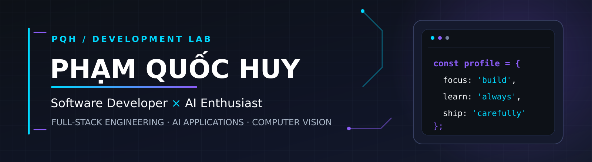
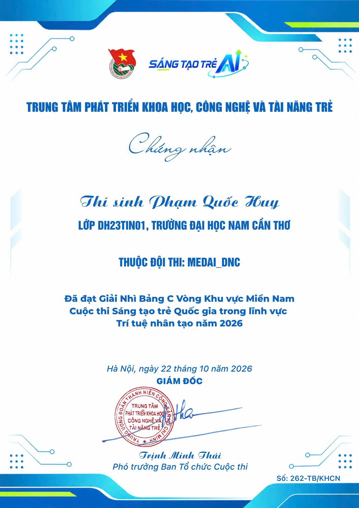
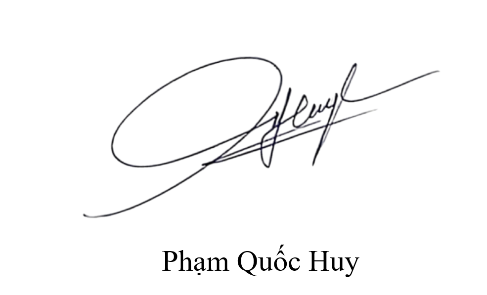

<!-- Phạm Quốc Huy • GitHub Profile • Premium Dark Tech • V4 -->

  

  <strong>Information Technology Student · Nam Can Tho University</strong> 
  Full-stack development · Practical AI · Computer vision

  <a href="https://github.com/PhamQuocHuy2k5">GitHub Profile</a> ·
  <a href="https://github.com/PhamQuocHuy2k5/Portfolio">Portfolio Source</a> ·
  <a href="https://github.com/PhamQuocHuy2k5?tab=repositories">Repositories</a>

---

## About me

I'm **Phạm Quốc Huy**, an Information Technology student at **Nam Can Tho University**, interested in building dependable web applications and applying AI to real-world problems.

My current work spans **React-based frontends, ASP.NET Core APIs, SQL Server**, and **Python services**. I care about clear user experiences, maintainable architecture, thoughtful testing, and communicating what a project *actually does* rather than overstating its readiness.

> **Build with purpose. Validate with evidence. Keep learning.**

## Technical toolkit

These are technologies I've used in coursework, experiments, or ongoing development — **not a claim of mastery**.

| Area | Technologies |
| --- | --- |
| **Languages** | `C#` · `Python` · `JavaScript` · `TypeScript` · `Java` · `SQL` |
| **Frontend** | `React` · `Vite` · `HTML5` · `CSS3` · `Tailwind CSS` |
| **Backend** | `ASP.NET Core` · `Entity Framework Core` · `FastAPI` |
| **Data** | `SQL Server` · `MongoDB` *(project exploration)* |
| **AI & Computer Vision** | `YOLO` · `OpenCV` · `Ollama` · `local LLM experimentation` |
| **Engineering & QA** | `Git` · `GitHub` · `VS Code` · `PowerShell` · `Playwright` · `Vitest` |

## Selected projects

### SMART TECH STORE · Public source · In development

**AI-assisted technology e-commerce and inventory intelligence.** A coursework project integrating a React storefront with an ASP.NET Core API, SQL Server, and Python services for forecasting and related analysis. Some planned AI capabilities and end-to-end integrations remain in progress, as documented in the repository.

**Stack:** `React` `TypeScript` `ASP.NET Core` `SQL Server` `FastAPI`  
**Explore:** [Repository & engineering status](https://github.com/PhamQuocHuy2k5/smart-tech-store)

### HEALORA AI · In development · No public project repository verified

**Local-first health information assistant.** Exploring Vietnamese conversational interfaces, Ollama-hosted models, retrieval-based responses, and safety-oriented AI interactions. An educational prototype, **not a medical professional or diagnostic service**.

**Focus:** `Ollama` `Python` `RAG research` `AI safety`  
**Status:** Project work in progress; no public demo claimed.

### YOLO TRAFFIC MANAGER · Academic project · Public repository not verified

**Computer-vision traffic analysis.** Developing vehicle and road-user detection, object tracking, and license-plate processing using Python-based image and video workflows. Accuracy and supported scenarios depend on evaluated models and input quality.

**Focus:** `Python` `YOLO` `OpenCV` `Object tracking` `OCR`  
**Status:** Academic project; no verified public demo linked.

### DTDM LEAFLET INTERACTIVE MAP · Public source

**Interactive web mapping coursework.** Browser-based maps using Leaflet, with Esri/OpenStreetMap basemap options and map interaction features described in its source repository.

**Stack:** `HTML` `CSS` `JavaScript` `Leaflet`  
**Explore:** [Source repository](https://github.com/PhamQuocHuy2k5/DTDM-Leaflet-Interactive-Map)

### PERSONAL PORTFOLIO · Public source

**Personal project showcase.** A public repository containing frontend portfolio materials. A verified production deployment is not claimed here.

**Stack:** `HTML` `CSS` `JavaScript`  
**Explore:** [Portfolio repository](https://github.com/PhamQuocHuy2k5/Portfolio)

## Recognition & involvement

- **Second Prize — MED AI 2026** *(award reported by the profile owner).* 
- University coursework focused on software development and applied AI.
- Participation in student activities and collaborative project work.

## Current focus

`Full-stack engineering` · `Software architecture` · `Applied AI` · `Computer vision` · `Local LLMs` · `Testing & documentation`

I'm especially interested in building end-to-end applications where the interface, API, data model, and AI components work together reliably.

## GitHub activity

GitHub provides up-to-date activity and language information directly on the account pages:

- [Contribution activity and repositories](https://github.com/PhamQuocHuy2k5)
- [Public repositories and their language breakdowns](https://github.com/PhamQuocHuy2k5?tab=repositories)

<strong>Optional live statistics — provided by third-party services</strong>

These cards are **external** and may become unavailable independently of this profile. The native GitHub activity links above remain accessible even when a card does not render.

  
  

## Connect

- **GitHub:** [@PhamQuocHuy2k5](https://github.com/PhamQuocHuy2k5)
- **Projects:** [View public repositories](https://github.com/PhamQuocHuy2k5?tab=repositories)
- **Portfolio source:** [Repository](https://github.com/PhamQuocHuy2k5/Portfolio)

  LEARN · BUILD · VERIFY · IMPROVE

<!-- AWARD-AI-2026-START -->

---

## 🏆 Honors & Awards

### 🥈 Second Prize — National Youth AI Innovation Competition 2026

**Southern Regional Round — Category C**

| Information | Details |
|---|---|
| Participant | Phạm Quốc Huy |
| Team | MEDAI_DNC |
| University | Nam Can Tho University |
| Major | Information Technology |
| Achievement | Second Prize |
| Category | Artificial Intelligence |
| Award Date | October 22, 2026 |

Awarded Second Prize as a member of MEDAI_DNC at the Southern Regional Round of the 2026 National Youth AI Innovation Competition.

This achievement represents an important milestone in my journey toward software engineering, artificial intelligence, technological innovation, and practical problem-solving.

  

  <em>Certificate of Achievement — National Youth AI Innovation Competition 2026</em>

### Official Recognition

- [Nam Can Tho University — Official News](https://nctu.edu.vn/news/category/all)
- [National Youth AI Innovation Competition](https://ai.tainangviet.vn/)

<!-- AWARD-AI-2026-END -->

<!-- GEMINI-CERTIFICATE-START -->

---

## 📜 Professional Certifications

### Google Gemini Certified Student — University

| Credential Information | Details |
|---|---|
| Certificate | Gemini Certified Student - University |
| Issued by | Google for Education |
| Recipient | Phạm Quốc Huy |
| Issued date | February 13, 2026 |
| Valid through | February 13, 2029 |
| Field | Artificial Intelligence |

Earned the Gemini Certified Student (University) credential from Google for Education, demonstrating foundational knowledge, skills, and competencies in using Google's artificial intelligence tools.

    

    <em>Google for Education - Gemini Certified Student 2026</em>

<!-- GEMINI-CERTIFICATE-END -->