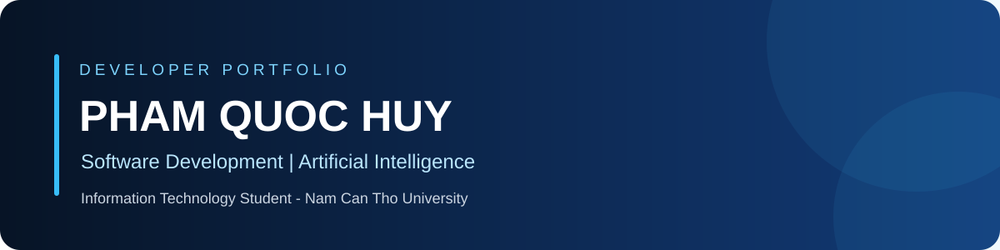

  

  
  
  

## About Me

I am an Information Technology student at Nam Can Tho University with a strong interest in software engineering, artificial intelligence, full-stack development, database systems and intelligent applications.

I work with multiple programming languages and technologies to develop practical software solutions across desktop applications, web platforms, computer vision and AI-powered systems.

My development philosophy focuses on functionality, reliability, data integrity, maintainability, security and user experience.

---

## Honors & Achievements

### Second Prize - National Youth AI Innovation Competition 2026

**Southern Regional Round | Category C**

- Team: MEDAI_DNC
- University: Nam Can Tho University
- Award date: October 22, 2026
- Field: Artificial Intelligence

Awarded Second Prize as a member of MEDAI_DNC, reflecting teamwork, technological innovation and the practical application of artificial intelligence.

---

## Professional Certifications

### Gemini Certified Student - University

**Google for Education**

- Issued: February 13, 2026
- Valid through: February 13, 2029
- Field: Artificial Intelligence

Demonstrated foundational knowledge, skills and competencies in using Google AI.

---

## Programming Languages

  

| Language | Application |
|---|---|
| Python | AI, Computer Vision, Automation |
| Java | Desktop Applications, OOP, Enterprise Systems |
| C# | Software Development, E-commerce |
| JavaScript | Web Applications, Interactive Systems |
| SQL | Database Design, Queries, Data Analytics |

## Technology Stack

### Web & Application Development

### Artificial Intelligence

- Large Language Models
- Retrieval-Augmented Generation
- Local AI with Ollama
- YOLO Object Detection
- Optical Character Recognition
- Computer Vision

### Database & Data Analytics

### Development Tools

- NetBeans
- StarUML
- Java Swing
- FlatLaf
- Database Management Tools

---

## Featured Projects

### HEALORA AI

Intelligent healthcare information assistant.

**Technologies:** JavaScript, MongoDB, Ollama, LLM, RAG.

Focus areas include local AI integration, Vietnamese health information, knowledge retrieval and responsible AI assistance.

### MEDAI_DNC

Healthcare AI innovation competition project.

**Achievement:** Second Prize, Southern Regional Round, Category C, National Youth AI Innovation Competition 2026.

### TECHSTORE MANAGER

Inventory management and business intelligence desktop application.

**Technologies:** Java 21, Swing, FlatLaf, SQL Server, JDBC, Excel.

Focus areas include inventory operations, sales analytics, data visualization and business reporting.

### SMART TECH STORE

AI-powered technology e-commerce academic project.

**Technologies:** C#, Web Development, Artificial Intelligence.

### YOLO TRAFFIC MANAGER

Computer vision application for traffic detection, tracking and statistics.

**Technologies:** Python, YOLO, OpenCV, OCR, SQL Server.

### LIBRARY MANAGEMENT SYSTEM

System analysis and software design project.

**Focus:** UML, Use Case, Class, Activity, Sequence and State Diagrams.

### LEAFLET INTERACTIVE MAP

Interactive geographic visualization application.

**Technologies:** JavaScript, HTML, CSS, Leaflet.js, Esri Basemaps.

---

## Software Engineering Competencies

| Competency | Focus |
|---|---|
| Software Development | Multi-language application development |
| System Architecture | Modular design and separation of responsibilities |
| Object-Oriented Programming | Classes, encapsulation and abstraction |
| Database Engineering | Relational databases and data integrity |
| Artificial Intelligence | LLM, RAG and Computer Vision |
| Software Quality | Testing, debugging and optimization |
| UI/UX | Modern and user-friendly applications |
| Data Analytics | Dashboards, reporting and visualization |
| Version Control | Git and GitHub |
| Technical Documentation | Reports, UML diagrams and presentations |

---

## Achievement Timeline

| Date | Milestone |
|---|---|
| February 2026 | Google Gemini Certified Student |
| October 2026 | Second Prize - National Youth AI Innovation Competition, Southern Regional Round |
| 2026 | Development of academic software and AI projects |

## Research & Learning Interests

- Artificial Intelligence and Intelligent Systems
- Large Language Models and RAG
- Computer Vision and Deep Learning
- Software Architecture
- Full-Stack Development
- Database Engineering
- Business Intelligence
- Responsible AI

## Career Objective

To develop into a skilled software engineer with strong capabilities in artificial intelligence, application development and system design, contributing to practical and reliable technology solutions.

## Portfolio & Contact

---

  <b>Learn continuously. Build responsibly. Improve through practice.</b>

  Selected project source code is maintained in private repositories.

